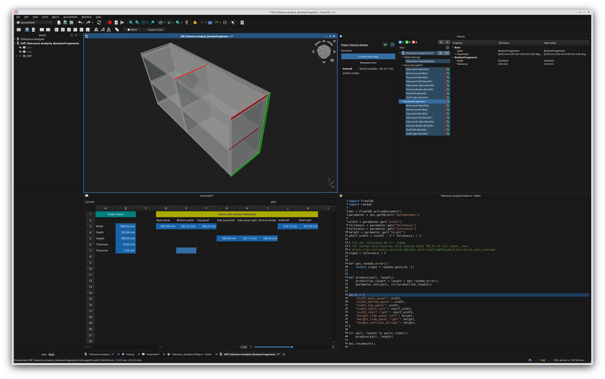

# Tolerance Analysis

This project demonstrates how to use the History Workbench in FreeCAD to visualize a tolerance analysis.
Please copy the file `Tolerance Analysis.zip` into a different folder outside of the FreeCAD-examples folder (because nested, independent git projects are not very well supported) and unzip it there.

